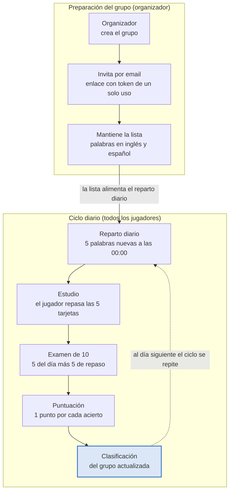
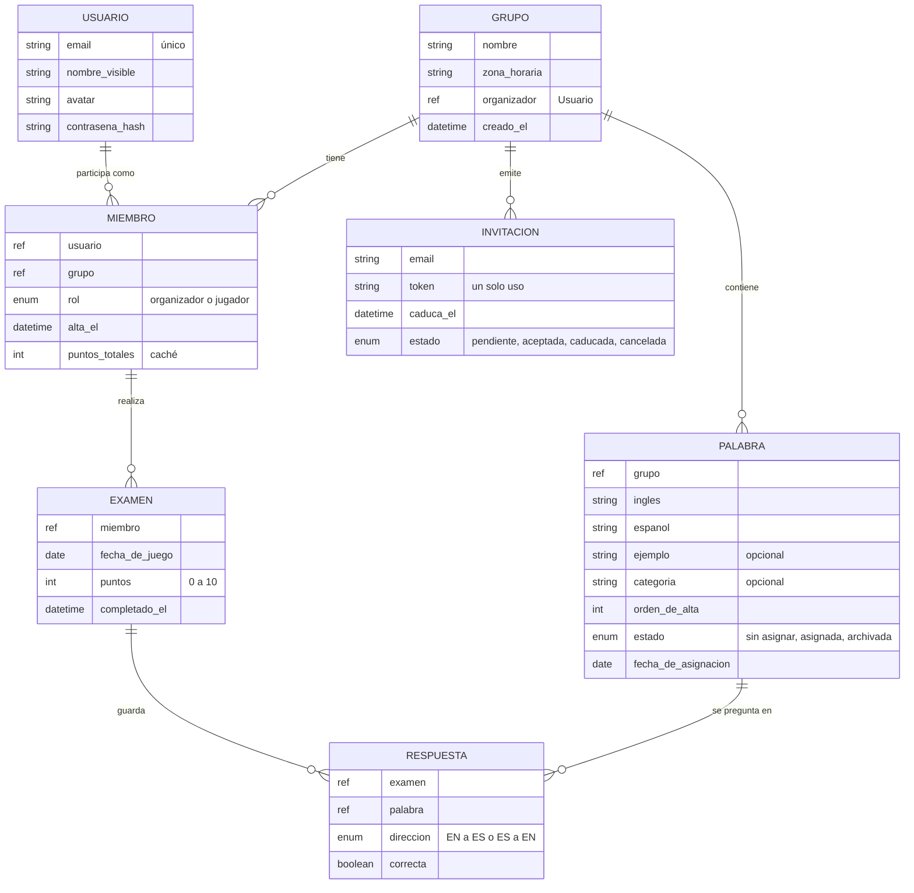

# Family English – Análisis de la aplicación

**Versión:** 1 · **Fecha:** 2026-10-12 · **Autor:** Jose Colomar

## Visión y objetivos

Family English es una aplicación para aprender vocabulario en inglés jugando en grupo: un organizador mantiene una lista de palabras, cada jugador recibe 5 palabras nuevas al día, hace un examen diario de 10 palabras y compite en la clasificación de su grupo.

El problema que resuelve es la falta de constancia al estudiar vocabulario en solitario. El grupo (una familia, una clase, un equipo de amigos) aporta presión social positiva y la clasificación convierte el estudio en un reto compartido.

Objetivos del producto:

- Que cada participante estudie vocabulario todos los días con un esfuerzo pequeño (5 palabras, un examen de 2 minutos).
- Que el organizador controle qué se aprende, sin depender de contenidos externos.
- Que la competición sea sana y motivadora: puntos por aciertos, nunca penalizaciones.
- Que repasar lo aprendido forme parte del juego, incluyendo palabras de días anteriores en cada examen.

## Roles y actores

Hay tres roles. El organizador es también jugador de su grupo, de modo que compite en igualdad de condiciones. Un mismo usuario puede tener roles distintos en grupos distintos.

| Rol | Quién es | Qué puede hacer |
| --- | --- | --- |
| Organizador | Usuario que crea el grupo | Invitar y expulsar participantes, mantener la lista de palabras (alta, edición, baja, importación), configurar el grupo, ver la clasificación y las estadísticas de todos |
| Jugador | Usuario que acepta una invitación | Ver sus 5 palabras del día, estudiarlas, hacer el examen diario, ver su historial y la clasificación del grupo |
| Invitado | Persona con una invitación pendiente | Aceptar o rechazar la invitación; registrarse si aún no tiene cuenta |

El sistema actúa como un cuarto actor: cada día asigna las palabras, abre el examen y actualiza la clasificación sin intervención humana.

## Flujo principal

La fila superior ocurre una vez (crear, invitar) o de forma continua (mantener la lista). La fila inferior se repite cada día para todos los jugadores del grupo, y la clasificación es la salida visible de cada ciclo.

## Requisitos funcionales

Se agrupan en seis módulos. Los marcados como MVP entran en la primera versión; el resto se detalla en la sección de fases.

| Id | Módulo | Requisito | MVP |
| --- | --- | --- | --- |
| RF-01 | Cuentas | Registro e inicio de sesión con email y contraseña; perfil con nombre visible y avatar | Sí |
| RF-02 | Cuentas | Recuperación de contraseña por email | Sí |
| RF-03 | Grupos | Un usuario crea un grupo con nombre y, opcionalmente, descripción e imagen; pasa a ser su organizador | Sí |
| RF-04 | Grupos | El organizador invita por email; el sistema envía un enlace con token de un solo uso y caducidad de 7 días | Sí |
| RF-05 | Grupos | El invitado acepta el enlace; si no tiene cuenta, se registra y queda unido al grupo automáticamente | Sí |
| RF-06 | Grupos | El organizador ve el estado de cada invitación (pendiente, aceptada, caducada) y puede reenviarla o cancelarla | Sí |
| RF-07 | Grupos | El organizador puede expulsar a un jugador; el jugador puede abandonar el grupo | Sí |
| RF-08 | Grupos | Un usuario puede pertenecer a varios grupos y cambiar entre ellos | Sí |
| RF-09 | Vocabulario | El organizador añade palabras con término en inglés, traducción en español y, opcionalmente, frase de ejemplo y categoría | Sí |
| RF-10 | Vocabulario | El organizador edita o elimina palabras; una palabra ya asignada no se elimina, se archiva | Sí |
| RF-11 | Vocabulario | Importación masiva desde CSV (inglés, español, ejemplo) | Sí |
| RF-12 | Vocabulario | El sistema avisa al organizador cuando quedan menos de 10 palabras sin asignar | Sí |
| RF-13 | Vocabulario | Pronunciación en audio de cada palabra (síntesis de voz del dispositivo) | No |
| RF-14 | Estudio | Cada día a las 00:00 (zona horaria del grupo) el sistema asigna 5 palabras nuevas, las mismas para todos los miembros del grupo | Sí |
| RF-15 | Estudio | El jugador ve sus 5 palabras del día como tarjetas: inglés, español y ejemplo | Sí |
| RF-16 | Estudio | El jugador puede repasar las palabras de días anteriores con un buscador | Sí |
| RF-17 | Examen | Un examen por jugador y día, con 10 preguntas: las 5 del día más 5 de días anteriores | Sí |
| RF-18 | Examen | Pregunta de tipo opción múltiple: se muestra el término en un idioma y 4 opciones en el otro | Sí |
| RF-19 | Examen | Pregunta de respuesta escrita: el jugador teclea la traducción | No |
| RF-20 | Examen | Al terminar se muestra el resultado, los fallos con la respuesta correcta y los puntos ganados | Sí |
| RF-21 | Examen | El examen de un día solo puede hacerse ese día; un día sin examen suma 0 puntos | Sí |
| RF-22 | Clasificación | Ranking del grupo por puntos totales, con posición, nombre, puntos y exámenes hechos | Sí |
| RF-23 | Clasificación | Vistas semanal y mensual además de la histórica | No |
| RF-24 | Clasificación | Historial personal: puntos por día y palabras falladas con más frecuencia | Sí |
| RF-25 | Notificaciones | Email o notificación push cuando hay palabras nuevas y recordatorio si el examen sigue sin hacer por la tarde | Sí |

## Reglas de juego

Las reglas son fijas para todos los grupos en el MVP; en fases posteriores el organizador podrá ajustar los números.

**Reparto diario de palabras**

1. A las 00:00 en la zona horaria del grupo, el sistema toma 5 palabras no asignadas todavía, en el orden en que el organizador las dio de alta.
2. Las 5 palabras son las mismas para todos los miembros del grupo, para que puedan comentarlas entre ellos.
3. Si quedan menos de 5 palabras sin asignar, se asignan las que haya y se avisa al organizador. Si no queda ninguna, ese día no hay examen.
4. Un jugador que se une a mitad de juego recibe las palabras del día en curso; las anteriores quedan disponibles para repasar, pero no para puntuar de forma retroactiva.

**Composición del examen diario**

1. 10 preguntas: las 5 palabras del día más 5 palabras de días anteriores de ese grupo.
2. Las 5 de repaso se eligen al azar, con prioridad para las que el jugador falló en exámenes anteriores y para las más antiguas que lleve tiempo sin ver.
3. Si el grupo aún no tiene 5 palabras de días anteriores (primeros días), el examen tiene menos preguntas: solo las disponibles.
4. Cada pregunta muestra el término en un idioma y 4 opciones en el otro; la dirección (inglés a español o español a inglés) se elige al azar por pregunta. Los distractores salen de otras palabras del grupo.
5. El orden de las preguntas y de las opciones es aleatorio y distinto para cada jugador.
6. Solo hay un intento por día. El examen se puede empezar en cualquier momento del día y, una vez empezado, se completa de una vez.

**Puntuación**

1. Cada acierto suma 1 punto. Un fallo suma 0; no hay puntos negativos.
2. El máximo diario es 10 puntos.
3. Los puntos se acumulan en el total del grupo desde el día en que el jugador se unió.
4. Empate en la clasificación: se desempata por mayor número de exámenes completados y, después, por antigüedad en el grupo.

## Gamificación

La clasificación por puntos es el motor principal y la única mecánica del MVP. Las demás se añaden en fases posteriores sin cambiar el modelo de puntos, para que el ranking siga siendo comparable.

| Mecánica | Descripción | Fase |
| --- | --- | --- |
| Clasificación del grupo | Ranking por puntos acumulados, con medalla visual para los tres primeros y flecha de subida o bajada respecto al día anterior | MVP |
| Resultado del día | Pantalla de cierre del examen con puntos del día, aciertos y posición actual en el grupo | MVP |
| Recordatorios | Aviso de palabras nuevas por la mañana y recordatorio por la tarde si el examen no está hecho | MVP |
| Racha | Días consecutivos con examen completado; se muestra junto al nombre y se pierde al saltarse un día | Fase 2 |
| Logros | Insignias por hitos: primer examen, 10 de 10, racha de 7 y 30 días, 100 palabras aprendidas, primero del mes | Fase 2 |
| Clasificaciones por periodo | Semanal y mensual, para que un recién llegado pueda ganar algo aunque vaya detrás en el total | Fase 2 |
| Retos entre miembros | El organizador lanza un reto puntual (fin de semana, palabras de una categoría) con puntos extra acotados | Fase 3 |
| Reacciones | Felicitar a otro jugador con un emoji al ver su resultado | Fase 3 |

Principios que deben respetarse en cualquier fase:

- Nunca se restan puntos: un mal día no castiga, solo deja de sumar.
- Los puntos extra de retos y logros se muestran por separado del total de exámenes, para que el ranking principal siga midiendo vocabulario aprendido.
- Un jugador puede silenciar los recordatorios sin salir del grupo.

## Modelo de datos

Como las 5 palabras del día son las mismas para todo el grupo y cada palabra se asigna una sola vez, el reparto diario no necesita tabla propia: basta la fecha de asignación en Palabra. La clasificación se calcula sumando los exámenes de cada miembro; los puntos totales se guardan en Miembro como caché para ordenar rápido.

## Pantallas de la aplicación

La aplicación se organiza en torno a una pantalla de inicio diaria con tres acciones: estudiar, examinarse y ver la clasificación. Las pantallas del organizador cuelgan de los ajustes del grupo.

| Pantalla | Quién la usa | Contenido principal |
| --- | --- | --- |
| Acceso | Todos | Inicio de sesión, registro, recuperar contraseña |
| Mis grupos | Todos | Lista de grupos del usuario con su posición en cada uno; botón para crear grupo; invitaciones pendientes |
| Crear grupo | Organizador | Nombre, descripción, zona horaria; al guardar lleva a invitar |
| Invitar | Organizador | Campo de emails, lista de invitaciones con estado y acciones reenviar o cancelar |
| Inicio del grupo | Todos | Las 5 palabras del día, estado del examen (pendiente o hecho con puntos), top 3 del ranking y acceso a las demás pantallas |
| Palabras del día | Jugador | Tarjetas con inglés, español y ejemplo; se pueden voltear para autoevaluarse |
| Repaso | Jugador | Buscador y lista de todas las palabras ya asignadas en el grupo, con marca de las falladas |
| Examen | Jugador | Una pregunta por pantalla, 4 opciones, barra de progreso 1 de 10 |
| Resultado | Jugador | Puntos del día, aciertos y fallos con la respuesta correcta, posición en el ranking |
| Clasificación | Todos | Ranking completo del grupo; en fase 2 pestañas semana, mes e histórico |
| Mi historial | Jugador | Puntos por día en un gráfico, total de palabras vistas, palabras más falladas |
| Vocabulario | Organizador | Tabla de palabras con estado (sin asignar, asignada, archivada), alta, edición, importación CSV y aviso de palabras restantes |
| Miembros | Organizador | Lista de miembros con fecha de alta y botón de expulsar |
| Perfil | Todos | Nombre, avatar, preferencias de notificaciones, cerrar sesión |

## Requisitos no funcionales y propuesta técnica

Se propone una aplicación web progresiva (PWA) que funcione en móvil y escritorio desde el navegador, con un backend ligero y tareas programadas para el reparto diario. Es la opción más rápida para un primer grupo de usuarios y no cierra la puerta a una app nativa más adelante.

**Requisitos no funcionales**

| Ámbito | Requisito |
| --- | --- |
| Dispositivos | Uso principal en móvil; diseño adaptable a tablet y escritorio |
| Idioma de la interfaz | Español en el MVP; textos externalizados para añadir otros |
| Rendimiento | El examen responde en menos de 200 ms por pregunta; la asignación diaria termina en menos de 1 minuto para todos los grupos |
| Disponibilidad | El examen debe poder hacerse en cualquier momento del día; si falla la asignación nocturna, se reintenta y se avisa al administrador |
| Seguridad | Contraseñas con hash, sesiones con token, acceso a datos de un grupo solo para sus miembros, tokens de invitación de un solo uso |
| Privacidad | Datos mínimos: email, nombre visible y resultados; cumplimiento del RGPD con borrado de cuenta a petición |
| Integridad del juego | Las respuestas correctas no viajan al cliente antes de responder; la corrección se hace en el servidor |
| Zona horaria | El día de juego se calcula con la zona horaria del grupo, no la del dispositivo |

**Propuesta técnica**

| Capa | Propuesta | Motivo |
| --- | --- | --- |
| Frontend | React con TypeScript, Vite y configuración PWA; Tailwind para la interfaz | Ecosistema maduro, instalable en móvil sin tiendas |
| Backend | Node.js con TypeScript (NestJS o Fastify) exponiendo una API REST | Mismo lenguaje en todo el proyecto |
| Base de datos | PostgreSQL | Modelo relacional claro (grupos, miembros, palabras, exámenes) y consultas de ranking sencillas |
| Tareas programadas | Un job diario por grupo a las 00:00 de su zona horaria, con cola de reintentos | Reparto de palabras y recordatorios |
| Email | Servicio transaccional (Resend, SendGrid o similar) | Invitaciones, recuperación de contraseña y recordatorios |
| Notificaciones push | Web Push en fase 2 | Recordatorios sin depender del email |
| Despliegue | Contenedores Docker; hosting gestionado (Railway, Render o Fly.io) con PostgreSQL gestionado | Coste bajo para pocos usuarios |
| Pruebas | Unitarias para las reglas de juego (asignación, composición del examen, puntuación) y de extremo a extremo para el flujo diario | Las reglas son el núcleo y deben ser deterministas |

Alternativa más simple: Supabase (PostgreSQL, autenticación y funciones programadas) como backend completo, reduciendo el código de servidor a las funciones de asignación y corrección del examen.

## Alcance del MVP y fases posteriores

El MVP cubre el ciclo completo que describe la idea original: crear el grupo, invitar, mantener palabras, recibir 5 al día, examinarse de 10 y ver la clasificación. Todo lo demás se aplaza hasta validar que el grupo juega a diario.

| Fase | Contenido | Criterio para pasar a la siguiente |
| --- | --- | --- |
| MVP | Cuentas, grupos e invitaciones por email, vocabulario con importación CSV, reparto diario, examen de opción múltiple, clasificación histórica, historial personal, recordatorio por email | Un grupo real juega 3 semanas seguidas con más del 70 % de exámenes completados |
| Fase 2 | Rachas, logros, clasificaciones semanal y mensual, notificaciones push, pronunciación en audio, reglas configurables por grupo (palabras por día, preguntas por examen) | Dos o más grupos activos piden variar las reglas |
| Fase 3 | Retos puntuales, reacciones entre jugadores, pregunta de respuesta escrita, listas de vocabulario compartidas entre grupos, app nativa si la PWA se queda corta | Demanda demostrada por el uso |

Fuera de alcance en todas las fases previstas: gramática, comprensión oral, conversación y contenidos generados por la propia aplicación. La app enseña el vocabulario que el organizador decide.

## Decisiones abiertas

Estas preguntas no están resueltas en la idea original. Para cada una se indica la opción asumida en este documento; cambiarla afecta a las reglas y al modelo de datos.

- [ ] ¿Las 5 palabras del día son las mismas para todo el grupo o distintas por jugador? Se asume las mismas, para favorecer la conversación en el grupo.
- [ ] ¿El examen es de opción múltiple o de respuesta escrita? Se asume opción múltiple en el MVP y escrita como opción en fase 3.
- [ ] ¿Qué pasa si un jugador no hace el examen un día? Se asume que pierde esos puntos sin posibilidad de recuperarlos.
- [ ] ¿El organizador también juega y puntúa? Se asume que sí, ya que conoce las palabras de antemano pero el objetivo es aprender, no competir en igualdad perfecta.
- [ ] ¿Se reparten palabras los fines de semana? Se asume que sí, todos los días; en fase 2 el organizador podrá excluir días.
- [ ] ¿Qué ocurre cuando se agota la lista de palabras? Se asume que no hay examen ese día y se avisa al organizador con antelación.
- [ ] ¿Plataforma inicial: PWA, app nativa o ambas? Se asume PWA.
- [ ] ¿Tamaño máximo de un grupo? Se asume sin límite técnico, pensado para entre 3 y 30 personas.
