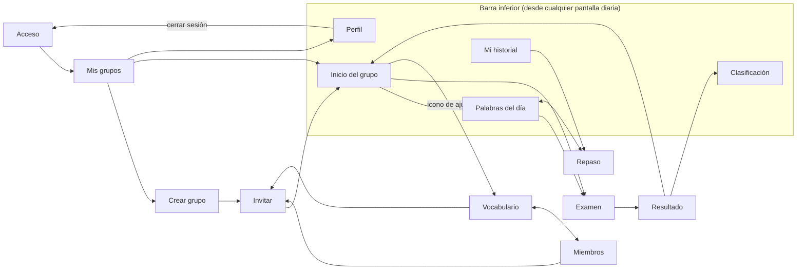

# Family English – Pantallas del MVP

**Versión:** 1 · **Fecha:** 2026-10-12 · **Autor:** Jose Colomar

Las 14 pantallas del MVP están diseñadas como maquetas interactivas de móvil (390 × 844) en el lienzo de diseño [Family English – Pantallas MVP](https://claude.ai/artifact/JCNxHe48RXJcREUYkM3Qzw). El código fuente de cada mesa de trabajo está copiado en [docs/pantallas/diseno/](pantallas/diseno/) para que quede versionado junto al proyecto. Este documento describe cada pantalla, sus elementos, sus estados y la navegación entre ellas, y complementa la tabla de pantallas de [analisis-v1.md](analisis-v1.md).

## Sistema visual

El diseño usa un único color de acento configurable por grupo y una paleta de estados fija. Todos los botones y enlaces principales miden al menos 44 px de alto.

| Elemento | Valor |
| --- | --- |
| Tipografía de títulos | Bricolage Grotesque, pesos 600 y 800 |
| Tipografía de texto | Nunito Sans, pesos 400 a 800 |
| Fondo de pantalla | `#F5F6FA` |
| Texto principal / secundario | `#161B33` / `#5A6178` |
| Acento por defecto | `#2F5BD3` (azul); alternativas `#0F7A6C`, `#6B3FC7`, `#B5402A` |
| Bordes y separadores | `#D5DAE6`, `#E3E6EE`, `#ECEEF4` |
| Aviso (palabras restantes, invitación pendiente) | fondo `#FFF4E5`, borde `#FFD7A1`, texto `#A34A0F`, icono `#FFB547` |
| Correcto / hecho | fondo `#E3F4EA`, texto `#165C3A`, icono `#1F8A55` |
| Error / acción destructiva | fondo `#FBEDEA`, texto `#A3321F` |
| Tarjetas | fondo blanco, radio 16 a 22 px, sombra suave |
| Marco del dispositivo | radio 28 px |

Convenciones repetidas en todas las pantallas:

- **Barra de navegación inferior** con cinco pestañas: Inicio, Palabras, Ranking, Historial y Perfil. Aparece en las pantallas de uso diario; no aparece en acceso, creación de grupo, examen, resultado ni en las pantallas de ajustes del organizador.
- **Cabecera de ajustes del organizador** con tres pestañas: Vocabulario, Miembros e Invitaciones.
- **Chips de filtro** (fondo oscuro cuando están activos) para alternar vistas dentro de una pantalla.
- **Insignias de estado** en texto pequeño con fondo de color según la paleta anterior.
- Iconos en SVG de trazo, nunca emojis.

## Mapa de navegación

## Inventario de pantallas

| # | Pantalla | Archivo | Rol | Barra inferior |
| --- | --- | --- | --- | --- |
| 1 | Acceso | `Main.dc.html` | Todos | No |
| 2 | Mis grupos | `MisGrupos.dc.html` | Todos | No |
| 3 | Crear grupo | `CrearGrupo.dc.html` | Organizador | No |
| 4 | Invitar | `Invitar.dc.html` | Organizador | No |
| 5 | Perfil | `Perfil.dc.html` | Todos | Sí |
| 6 | Inicio del grupo | `InicioGrupo.dc.html` | Todos | Sí |
| 7 | Palabras del día | `PalabrasDelDia.dc.html` | Jugador | No |
| 8 | Examen | `Examen.dc.html` | Jugador | No |
| 9 | Resultado | `Resultado.dc.html` | Jugador | No |
| 10 | Clasificación | `Clasificacion.dc.html` | Todos | Sí |
| 11 | Repaso | `Repaso.dc.html` | Jugador | Sí |
| 12 | Mi historial | `Historial.dc.html` | Jugador | Sí |
| 13 | Vocabulario | `Vocabulario.dc.html` | Organizador | No (pestañas de ajustes) |
| 14 | Miembros | `Miembros.dc.html` | Organizador | No (pestañas de ajustes) |

## Detalle por pantalla

### 1. Acceso

Pantalla de entrada con logotipo, titular «Cinco palabras al día. Todo el grupo jugando.» y un selector de dos pestañas: Iniciar sesión y Crear cuenta.

- **Estados:** inicio de sesión (email y contraseña), registro (añade el campo Nombre visible) y recuperación de contraseña (solo email, botón Enviar enlace y confirmación «Enlace enviado»).
- **Acciones:** Entrar o Crear cuenta llevan a Mis grupos; «¿Olvidaste tu contraseña?» pasa al estado de recuperación; «Volver a iniciar sesión» regresa.
- **Nota de privacidad** al pie: solo se guardan email, nombre visible y resultados.
- Requisitos cubiertos: RF-01, RF-02.

### 2. Mis grupos

Lista de los grupos del usuario y de las invitaciones pendientes, con acceso al perfil desde el avatar de la cabecera.

- **Invitación pendiente:** tarjeta en color de aviso con nombre del grupo, quién invita, días hasta la caducidad y botones Aceptar y Rechazar.
- **Tarjeta de grupo:** iniciales del grupo con el color de acento, nombre, insignia de rol (Organizador o Jugador), posición actual («2º de 6»), puntos acumulados y estado del examen de hoy (pendiente en naranja, hecho en verde con la nota «9/10»).
- **Acción:** botón con borde discontinuo «Crear un grupo».
- Requisitos cubiertos: RF-05, RF-08.

### 3. Crear grupo

Formulario del paso 1 de 2 para crear un grupo.

- **Campos:** imagen del grupo (opcional), nombre, descripción (opcional) y zona horaria (desplegable).
- **Mensaje informativo:** recuerda que cada día a las 00:00 de esa zona horaria se reparten 5 palabras nuevas, las mismas para todo el grupo.
- **Acción:** «Crear y seguir con invitaciones» lleva a Invitar. La flecha de la cabecera vuelve a Mis grupos.
- Requisitos cubiertos: RF-03.

### 4. Invitar

Paso 2 de 2 al crear el grupo y, después, pestaña Invitaciones dentro de los ajustes.

- **Entrada de emails:** campo con los emails añadidos como chips eliminables y botón «Enviar invitaciones». El texto explica que el enlace es de un solo uso y caduca en 7 días.
- **Lista de invitaciones enviadas:** email, insignia de estado (Pendiente, Aceptada, Caducada) y detalle de fecha; contador «5 aceptadas de 7». Las pendientes tienen botones Reenviar y Cancelar; las caducadas solo Reenviar; las aceptadas no tienen acciones.
- **Acción:** «Ir al grupo» lleva a Inicio del grupo.
- Requisitos cubiertos: RF-04, RF-06.

### 5. Perfil

Datos del usuario y preferencias de aviso.

- **Datos:** avatar con botón para cambiarlo, nombre visible editable y email de solo lectura.
- **Notificaciones:** tres interruptores: Palabras nuevas (aviso por la mañana), Recordatorio de examen (por la tarde si no está hecho) y Silenciar el grupo actual (sigue en el grupo sin avisos).
- **Canal de aviso:** Email activo; Push deshabilitado con etiqueta «pronto».
- **Acciones:** Cerrar sesión (vuelve a Acceso) y «Eliminar mi cuenta y mis datos» en estilo destructivo.
- Requisitos cubiertos: RF-01, RF-25 y el borrado de cuenta del apartado de privacidad.

### 6. Inicio del grupo

Pantalla principal de cada día. La cabecera muestra la fecha y el nombre del grupo con un desplegable para cambiar de grupo, y un icono de ajustes que lleva a Vocabulario.

- **Tarjeta del examen de hoy** en color de acento: insignia PENDIENTE, «10 preguntas · unos 2 minutos», «+10 pts posibles» y botón «Empezar examen».
- **Tus 5 palabras de hoy:** las cinco palabras en inglés como chips y enlace «Estudiar».
- **Clasificación:** top 3 con medallas de color (oro, plata, bronce), la fila propia resaltada y enlace «Ver todo».
- **Aviso al organizador:** banda en color de aviso «Quedan 8 palabras sin asignar» que lleva a Vocabulario. Solo se muestra al organizador cuando quedan menos de 10.
- Requisitos cubiertos: RF-12, RF-14, RF-22.

### 7. Palabras del día

Estudio de las 5 palabras del día con tarjetas que se voltean.

- **Progreso:** cinco puntos en la parte superior; el actual se alarga con el color de acento, los marcados como sabidos se ponen en verde. Contador «2 de 5 · 1 sabidas».
- **Tarjeta:** anverso con la palabra en inglés, la categoría y la pista «Piensa la traducción y toca para comprobar». Reverso en color de acento con la traducción, la palabra en inglés y la frase de ejemplo entre comillas.
- **Acciones:** «Repasar otra vez» pasa a la siguiente sin marcar; «Me la sé» la marca como sabida y pasa a la siguiente; «Ir al examen» lleva al examen. Enlace «Repaso» en la cabecera.
- Requisitos cubiertos: RF-15.

### 8. Examen

Una pregunta por pantalla, con 10 preguntas en total.

- **Cabecera:** «Pregunta 8 de 10», aviso «Un solo intento» con icono de candado y barra de progreso.
- **Pregunta:** insignia con la dirección (Inglés → Español o Español → Inglés), texto «¿Cómo se dice…?» y el término en tamaño grande.
- **Opciones:** cuatro botones con letra A a D. La opción elegida se resalta con borde y fondo del color de acento.
- **Acciones:** «Siguiente» deshabilitado hasta elegir una opción; en la última pregunta cambia a «Terminar y ver resultado».
- Requisitos cubiertos: RF-17, RF-18, RF-21.

### 9. Resultado

Cierre del examen del día.

- **Resumen:** anillo con «8/10 aciertos» y mensaje «¡Muy bien, Jose!».
- **Dos tarjetas:** Puntos de hoy («+8», «Total: 274») y Posición («2º», «a 7 puntos de Lucía»).
- **Tus fallos:** lista de las palabras falladas con la respuesta correcta y la opción elegida, indicando si era palabra de repaso.
- **Acciones:** «Ver clasificación» y «Volver al inicio».
- Requisitos cubiertos: RF-20.

### 10. Clasificación

Ranking completo del grupo.

- **Selector de periodo:** Histórico activo; Semana y Mes deshabilitados con etiqueta «F2» (fase 2).
- **Podio:** los tres primeros con avatar, nombre, puesto y puntos; el primero destacado con corona.
- **Tabla:** columnas #, Jugador, Exámenes y Puntos. Junto al nombre, una flecha de tendencia (▲1 sube, ▼1 baja, = sin cambios) con color según el sentido. La fila propia va resaltada.
- **Nota de desempate:** gana quien ha hecho más exámenes y, después, quien lleva más tiempo en el grupo.
- Requisitos cubiertos: RF-22, RF-23 (visible pero deshabilitado).

### 11. Repaso

Todas las palabras ya asignadas en el grupo, agrupadas por día.

- **Buscador** en inglés o español, con mensaje «Ninguna palabra coincide con la búsqueda» cuando no hay resultados.
- **Filtros:** «Todas · 175» y «Falladas · 9».
- **Lista:** secciones por fecha («Hoy · 12 oct», «Ayer · 11 oct», «10 oct») con cada palabra en inglés y español; las falladas llevan la insignia «Fallada N veces».
- **Enlace:** «Palabras de hoy» en la cabecera.
- Requisitos cubiertos: RF-16, RF-24.

### 12. Mi historial

Estadísticas personales dentro del grupo.

- **Tres indicadores:** puntos totales, exámenes hechos sobre posibles («34/35») y palabras vistas.
- **Puntos por día:** gráfico de barras de los últimos 14 días con la media y la barra de hoy en color de acento. Un día sin examen se dibuja como barra discontinua en rojo con la leyenda «sin examen, 0 puntos».
- **Las que más fallas:** lista de palabras con su número de fallos y enlace «Repasarlas» hacia Repaso.
- Requisitos cubiertos: RF-24.

### 13. Vocabulario (organizador)

Gestión de la lista de palabras, primera pestaña de los ajustes del grupo.

- **Aviso:** «Quedan 8 sin asignar: alcanzan para mañana y pasado».
- **Acciones:** «Añadir palabra» despliega un formulario en línea con Inglés, Español y Ejemplo (opcional) y botones Cancelar y Guardar; «Importar CSV» abre la importación masiva.
- **Filtros:** Todas, Sin asignar, Asignadas y Archivadas, cada uno con su recuento.
- **Lista:** palabra en inglés y español, insignia de estado y metadato (número de orden y «mañana» para las pendientes; fecha y categoría para las asignadas; motivo para las archivadas). Botón de editar en cada fila.
- Requisitos cubiertos: RF-09, RF-10, RF-11, RF-12.

### 14. Miembros (organizador)

Segunda pestaña de los ajustes del grupo.

- **Cabecera de lista:** «6 miembros · 1 invitación pendiente» y enlace «Invitar».
- **Lista:** avatar con inicial, nombre, insignia Organizador cuando corresponde, fecha de alta y puntos. Cada jugador tiene botón «Expulsar»; el organizador no.
- **Confirmación en línea:** al pulsar Expulsar aparece el texto «¿Expulsar a Nombre? Dejará de ver el grupo y saldrá de la clasificación» con botones Cancelar y «Sí, expulsar».
- **Pie:** zona horaria del grupo y hora del reparto diario.
- Requisitos cubiertos: RF-07.

## Pantallas del análisis sin maqueta

Todas las pantallas listadas en el análisis tienen maqueta. Dos flujos quedan descritos pero sin pantalla propia porque se resuelven dentro de otras: la importación CSV (botón en Vocabulario, falta la pantalla de carga y validación) y la edición de una palabra (botón en cada fila de Vocabulario, falta el formulario). Conviene diseñarlas antes de implementar el módulo de vocabulario.

## Cómo usar los archivos de diseño

Cada archivo `.dc.html` en `docs/pantallas/diseno/` es una mesa de trabajo del lienzo: contiene el marcado completo de la pantalla con sus estilos en línea y un pequeño bloque de lógica para los estados interactivos. `canvas.json` guarda la posición y el título de cada mesa. Los archivos dependen de `support.js`, que sirve el propio lienzo, así que no se renderizan solos al abrirlos en el navegador; para verlos interactivos hay que usar el enlace del lienzo. Su valor en el repositorio es servir de referencia exacta de colores, textos, tamaños y comportamientos al implementar los componentes.
